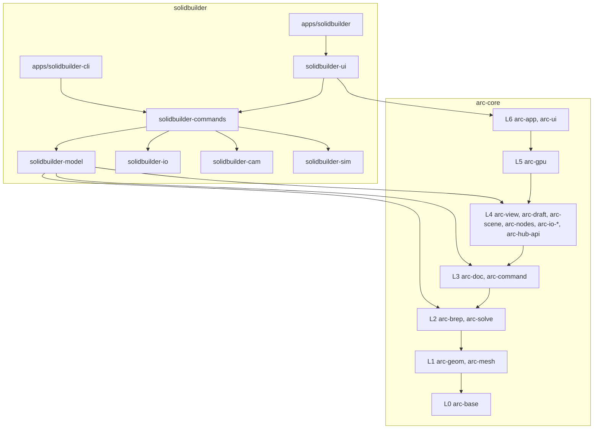

# SolidBuilder

> **Status: design phase.** No builds are available yet. This repository contains the product definition, architecture and roadmap that implementation follows.

SolidBuilder is a native, open-source parametric modeling application for mechanical design: parts
built from sketches and features with a robust feature history, surfaces and freeform shapes, sheet
metal, plastic parts, frames and weldments, assemblies with joints and motion, associative drawings and
model-based definition, and manufacturing preparation, simulation, electronics design and co-design, and exchange with other applications through connectors. Documents
are local `.solidb` files with a published schema; collaboration through Arc Hub is optional.

## Who it is for

Machine and product designers, sheet metal and fabrication shops, CNC programmers, additive
manufacturing users, analysis engineers, electronics hardware teams that design enclosures, and design
automation engineers who build configurable products and code-first part libraries. See the
[product vision](docs/product/vision.md).

## Capability areas

| Area | Scope | Specification |
|---|---|---|
| Documents and components | Document structure, components, multi-body parts, workspace, measurement, recovery | [01](docs/product/capabilities/01-documents-and-components.md) |
| Sketching and reference geometry | Sketches, constraints, solver, datums | [02](docs/product/capabilities/02-sketching-and-reference-geometry.md) |
| Solid features | Feature history, repair, features, patterns | [03](docs/product/capabilities/03-solid-features.md) |
| Surfacing | Surface creation, editing, quality analysis | [04](docs/product/capabilities/04-surfacing.md) |
| Freeform and mesh | Subdivision bodies, mesh bodies, conversion | [05](docs/product/capabilities/05-freeform-and-mesh.md) |
| Direct editing | Face edits, live rules, feature recognition | [06](docs/product/capabilities/06-direct-editing.md) |
| Sheet metal | Rules, flanges, flat patterns | [07](docs/product/capabilities/07-sheet-metal.md) |
| Plastic parts and molds | Plastic features, moldability, tooling | [08](docs/product/capabilities/08-plastic-parts-and-molds.md) |
| Assemblies | Joints, constraints, motion, interference, large assemblies | [09](docs/product/capabilities/09-assemblies.md) |
| Parameters and configurations | Parameters, configurations, states | [10](docs/product/capabilities/10-parameters-and-configurations.md) |
| Properties and BOM | Properties, materials, bills of materials | [11](docs/product/capabilities/11-properties-and-bom.md) |
| Drawings | Views, dimensions, annotations, tables, output | [12](docs/product/capabilities/12-drawings.md) |
| Model-based definition | Semantic 3D annotation and exchange | [13](docs/product/capabilities/13-model-based-definition.md) |
| Frames and weldments | Frame members, welds, cut lists | [14](docs/product/capabilities/14-frames-and-weldments.md) |
| Standard parts and generators | Library, feature templates, calculated generators | [15](docs/product/capabilities/15-standard-parts-and-generators.md) |
| Automation | Commands, protocol, code-first modeling, rules, plug-ins | [16](docs/product/capabilities/16-automation-and-api.md) |
| Visualization and animation | Display, appearances, rendering, explosions, animation | [17](docs/product/capabilities/17-visualization-and-animation.md) |
| Data management | References, versions, branches, Arc Hub, multi-user editing | [18](docs/product/capabilities/18-data-management.md) |
| Interoperability | Import and export | [19](docs/product/capabilities/19-interoperability.md) |
| Routed systems | Tube, pipe and harness routing | [20](docs/product/capabilities/20-routed-systems.md) |
| Manufacturing setup and tooling | Setups, tools, machines, posting | [21](docs/product/capabilities/21-manufacturing-setup-and-tooling.md) |
| Milling | 2.5-axis to multi-axis milling | [22](docs/product/capabilities/22-milling.md) |
| Turning and mill-turn | Turning operations | [23](docs/product/capabilities/23-turning-and-mill-turn.md) |
| Additive manufacturing | Build preparation | [24](docs/product/capabilities/24-additive-manufacturing.md) |
| Nesting and fabrication | Sheet nesting and cutting | [25](docs/product/capabilities/25-nesting-and-fabrication.md) |
| Simulation | Studies through open solvers | [26](docs/product/capabilities/26-simulation.md) |
| Generative design and optimization | Topology optimization and outcomes | [27](docs/product/capabilities/27-generative-design-and-optimization.md) |
| Electronics co-design | Board exchange with open ECAD tools | [28](docs/product/capabilities/28-electronics-codesign.md) |
| Tolerance and inspection | Stack analysis and inspection | [29](docs/product/capabilities/29-tolerance-and-inspection.md) |
| Schematic capture | Sheets, symbols, nets, rule checking, variants, netlist | [30](docs/product/capabilities/30-schematic-capture.md) |
| PCB layout | Stack-up, placement, routing, pours, design rules, 3D board | [31](docs/product/capabilities/31-pcb-layout.md) |
| Electronics simulation and outputs | SPICE, signal-integrity checks, manufacturing outputs, libraries | [32](docs/product/capabilities/32-electronics-simulation-and-outputs.md) |
| Application connectors | Native files of other applications through connectors | [33](docs/product/capabilities/33-application-connectors.md) |

## How it fits in the suite

SolidBuilder is one of the [Arc suite](https://github.com/ACKaraca/arc-suite) applications and builds on
[arc-core](https://github.com/ACKaraca/arc-core). It cooperates with other Arc products at run time
through the three suite contracts:

- **Arc document package:** `.solidb` documents are SQLite packages with a documented schema.
- **Arc Scene contract:** photoreal rendering and visualization through
  [RenderBuilder](https://github.com/ACKaraca/renderbuilder) and live scenes for
  [MeshBuilder](https://github.com/ACKaraca/meshbuilder).
- **Hub API:** versions, lifecycles, items, issues, automation jobs and multi-user editing through
  [Arc Hub](https://github.com/ACKaraca/arc-hub).

Models are reviewed and federated in [Arc Review](https://github.com/ACKaraca/arc-review) through STEP,
glTF and IFC.

## Architecture at a glance

Details: [architecture overview](docs/architecture/overview.md),
[feature history](docs/architecture/feature-history.md),
[geometry kernel](docs/architecture/geometry-kernel.md).

## Roadmap summary

| Milestone | Suite phase | Theme |
|---|---|---|
| M0 | 0–2 | Kernel readiness |
| M1 | 3 | Part modeling |
| M2 | 3 | Assemblies and drawings |
| M3 | 4 | Product breadth |
| M4 | 5 | Manufacturing preparation |
| M5 | 5 | Analysis, optimization and multi-user editing |

See the [roadmap](docs/roadmap.md).

## Documentation

The [documentation map](docs/README.md) lists every document. Automated coding agents start with
[AGENTS.md](AGENTS.md).

## Contributing

See [CONTRIBUTING.md](CONTRIBUTING.md) and the suite contribution guide it links. Security reports
follow [SECURITY.md](SECURITY.md).

## License

Apache License 2.0; see [LICENSE](LICENSE) and [NOTICE](NOTICE).

## Trademark notice

Arc, ArchBuilder, DraftBuilder, CivilBuilder, SolidBuilder, MeshBuilder, RenderBuilder, Arc Review and Arc Hub are names of this project and are not covered by the Apache License; see the [trademark policy](https://github.com/ACKaraca/arc-suite/blob/main/TRADEMARKS.md). All other product and company names are trademarks of their respective owners and are used only to describe scope and interoperability.
