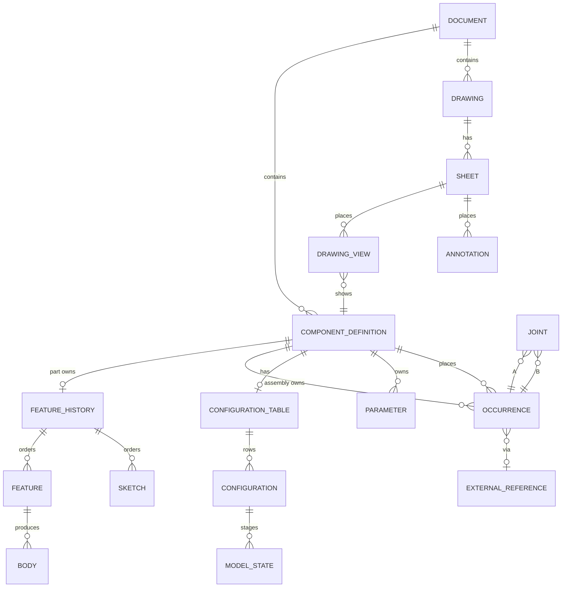
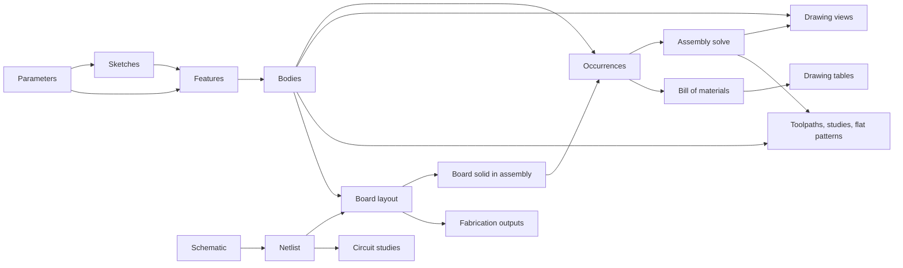

# Domain model

This document defines SolidBuilder's object types, their relationships, invariants, identity rules and
regeneration rules. Every object listed is a typed object in the `arc-doc` store with a stable 128-bit
ID and a schema version, changed only by commands inside transactions.

## Object types

### Documents and components

| Object | Key properties | Notes |
|---|---|---|
| Document | ID, schema version, settings (display units, modeling tolerance, drawing standard default, up axis), workspace hints | One SQLite package; holds any number of definitions and drawings ([ADR 0001](../adr/0001-document-structure-by-choice.md)) |
| Component definition | ID, kind (part, assembly), name, history enabled, configuration table, properties, material | Parts own feature histories and bodies; assemblies own occurrences and relations |
| Occurrence | ID, parent assembly, target definition ID (local or external reference), configuration, model state, transform, flags (grounded, suppressed, hidden, flexible, adaptive, excluded from BOM), load state | Placement of a definition |
| External reference | ID, target document ID, target definition ID, path hints, pinned version or latest, status | Resolved through the workspace |
| Body | ID, kind (solid, sheet, wire, mesh, subdivision), producing entry, material override, appearance override | Geometry is a cached derivative for history-enabled parts |

### History and geometry inputs

| Object | Key properties | Notes |
|---|---|---|
| Feature history | Owner definition, ordered entry IDs, rollback marker index | [Feature history](feature-history.md) |
| Feature | ID, kind, parameters (expressions), inputs (persistent references, profiles, queries), operation mode, participating bodies, suppressed, health, comment | Includes direct-edit entries and plug-in features |
| Feature group | ID, name, first and last entry | Contiguous range |
| Sketch | ID, plane (persistent reference or datum), entities, constraints, dimensions, solve state | 2D or 3D |
| Sketch entity | ID, kind (point, line, arc, circle, ellipse, spline, conic, text), geometry, construction flag | Owned by a sketch |
| Sketch constraint | ID, kind, entity IDs, value expression for dimensional kinds, driving or driven | Owned by a sketch |
| Reference geometry | ID, kind (datum plane, axis, point, coordinate system), construction method, inputs | History entry |
| Persistent reference | Name tuple, signature, pick parameters, resolution state | Embedded value in other objects, not a standalone object |
| Parameter | ID, owner, name, kind, unit type, expression, value, tolerance, flags | Names unique per owner |

### Variants and states

| Object | Key properties | Notes |
|---|---|---|
| Configuration table | Owner definition, columns (aspect descriptors), rows | One per definition |
| Configuration | ID, row values, part number, name | Row of a configuration table |
| Model state | ID, configuration, suppression and parameter overrides, substitute flag | Stage of a configuration |
| Display state | ID, owner, visibility and appearance overrides, camera | Presentation |
| Position state | ID, assembly, joint values | Mechanism pose |
| Simplified representation | ID, source occurrences, method, options, cached body | Envelope or wrapped substitute |

### Assemblies

| Object | Key properties | Notes |
|---|---|---|
| Joint | ID, kind, connection frame A and B, offsets, limits, rest value, suppressed | Between two occurrences |
| Connection frame | ID, owner (definition or assembly), origin and axes from persistent references, flip, offset | Anchor for joints |
| Assembly constraint | ID, kind, references, offset expression, suppressed | Solved with joints |
| Rigid group | ID, member occurrence IDs | |
| Motion coupling | ID, joint A and B, kind, ratio expression | |
| Contact set | ID, member occurrence IDs, enabled | |
| Motion study | ID, driven joints, ranges, steps | |
| Exploded state | ID, assembly, ordered steps (occurrence IDs, displacement) | |
| Animation sequence | ID, assembly, tracks of keyed actions | |

### Fabrication and libraries

| Object | Key properties | Notes |
|---|---|---|
| Sheet metal rule | ID, material, thickness, bend radius, unfold method (K-factor, allowance, deduction, table), relief and corner settings | Assigned per part or configuration |
| Flat pattern | ID, owner part, orientation, A-side face reference, bend order | Derived from the formed body |
| Plastic rule | ID, nominal wall, draft, rib and boss proportions | |
| Frame member | ID, profile section, path reference, orientation, end treatments | Generated part occurrence |
| Weld | ID, kind, face references, size, length pattern, symbol data, bead body | Owned by a weldment assembly |
| Library family | ID, standard, template definition, size table, naming rule | In a library document |
| Component generator | ID, kind, inputs, results, generated occurrence IDs | Owns generated occurrences |

### Properties, BOM and drawings

| Object | Key properties | Notes |
|---|---|---|
| Property definition | Key, type, scope, allowed values | Document, library or Hub scope |
| Property value | Definition key, value or expression, source | On definitions, configurations or occurrences |
| Material | ID, physical constants, appearance link | Library or document |
| Appearance | ID, Arc Scene material parameters, textures | |
| Bill of materials | Owner assembly, view kind, configuration, numbering, overrides | Derived; only overrides and numbering are stored |
| Drawing | ID, standard, sheet IDs, source list | |
| Sheet | ID, size, format, view IDs, annotation IDs | |
| Drawing view | ID, kind, source definition, configuration and states, orientation, scale, style, parent view | Projection is derived |
| Annotation | ID, kind, attachment (persistent reference or view curve name), values, style | |
| Table | ID, kind, data source, columns | |
| 3D annotation | ID, kind, annotation plane, semantic values, targets | Model-based definition |

### Electronics

The electronics objects live in the same document as the mechanical objects, are changed only by
commands in transactions and use the drafting engine for sheets and drawings. The object tables are
in [schematic capture](../product/capabilities/30-schematic-capture.md),
[PCB layout](../product/capabilities/31-pcb-layout.md) and
[electronics simulation and outputs](../product/capabilities/32-electronics-simulation-and-outputs.md).

| Object | Key properties | Notes |
|---|---|---|
| Schematic, sheet, symbol instance, net, bus, variant, design block | Sheet set, designators, pins, net classes, fitted state | Netlist, bill of materials and rule findings are derived |
| Board, stack-up, footprint instance, track, via, zone, rule set, panel | Outline linked to the mechanical model, layers, copper, rules | Filled zones, ratsnest and rule findings are derived |
| Circuit study, waveform set, signal-integrity check | Netlist revision, engine, results | Results are derived assets |
| Output job, output set, library part, supplier record | Board revision, variant, formats, part fields | Output files are derived and carry their revision |

### Data management, automation and downstream objects

| Object | Key properties | Notes |
|---|---|---|
| Version, named version, branch, change set | Journal ranges, names, base revisions | Stored in the journal and Hub |
| Import record, loss report, preserved foreign data, linked import | Source asset, options, findings, raw data | [Interoperability](interoperability.md) |
| Rule, form, trigger, script, node graph, plug-in feature | Source or graph, scope, bindings | [Automation](../product/capabilities/16-automation-and-api.md) |
| Manufacturing setup, operation, tool, machine definition, toolpath, NC program | Stock, coordinate system, strategies, cached toolpaths | `solidbuilder-cam`; toolpaths are derived |
| Study, load case, load, restraint, contact, mesh settings, result set | Idealization, solver, results file assets | `solidbuilder-sim`; results are derived assets |
| Design space, outcome | Preserve and obstacle geometry, criteria, generated bodies | Generative design |
| Board link | Board outline, component placements, keep-outs, source file asset | Exchange with open ECAD tools |
| Connector exchange | Exchange package asset, round-trip map, session record, loss report | Native files of other applications ([application connectors](../product/capabilities/33-application-connectors.md)) |
| Machine connection | Protocol, endpoint, security mode, credential reference, node map | Belongs to a machine definition; read-only status and explicit program transfer |
| Tolerance stack | Contributing dimensions, method, results | Tolerance analysis |

## Relationships

## Invariants

1. Every change to any object above happens in a transaction produced by a command; derived data
   (bodies of history-enabled parts, tessellation, projections, BOM rows, toolpaths, results) is never
   edited directly.
2. Feature inputs refer only to entries earlier in the same history, to parameters, to reference
   geometry, or to other components through declared cross-component references.
3. The dependency graph is acyclic. A command that would create a cycle (parameter expressions,
   cross-component references, adaptive geometry) is rejected before commit with the cycle listed.
4. Every created topological entity has a persistent name; a feature that cannot name an entity fails.
5. A broken persistent reference is never resolved to another entity without a user action or an
   accepted signature match above threshold.
6. Parameter names are unique per owner; property definition keys are unique per scope.
7. An occurrence's target exists or its reference is marked missing; a missing target never deletes
   the occurrence.
8. A configuration row has a value for every column or inherits the default row's value explicitly.
9. A released item (Hub lifecycle) is read-only in the document; edits require a new revision.
10. Results applied to the model or views carry the current revision; stale results are discarded.
11. A merge commit never drops either side's value of a conflicting property without a recorded choice.
12. The netlist is derived from the schematic and tagged with its revision; the board changes its
    connectivity only through an accepted change set from the schematic or an accepted board link
    proposal, and a stale netlist is never used.
13. Manufacturing outputs of a board carry the board revision and variant they were written from; an
    output older than the board is marked out of date and cannot be released.
14. A connector exchange changes the document only through a reviewed change set, and an unmatched
    host identifier is reported, never matched silently.

## Identity rules

| Rule | Detail |
|---|---|
| Stable IDs | Every object has a 128-bit ID assigned at creation and never reused. Copying an object assigns a new ID and records the source ID. |
| Moves between documents | Moving a component definition between documents keeps its ID; references are rewritten by document ID. |
| Topological identity | Faces, edges and vertices have no stable IDs; they are identified by persistent names derived from features ([ADR 0002](../adr/0002-persistent-naming.md)). |
| Configurations | A configuration is identified by its row ID, not its name; renaming keeps references. |
| Imported objects | Keep their source identifiers in the import record's identifier map. |
| Library items | Identified by family ID plus row key; generated member documents record both. |
| Hub identity | Hub items map to component definition and configuration IDs; part numbers are properties, not identities. |

## Regeneration and dependency rules

| When this changes | This recomputes |
|---|---|
| Parameter | Dependent sketches and features in order, then everything downstream |
| Sketch | Its solve, then features consuming its profiles or curves |
| Feature | Itself and downstream entries on affected bodies or consuming its outputs |
| Body of a definition | Tessellation, mass properties, occurrences in open assemblies, cross-component references, flat patterns |
| Occurrence transform or configuration | Its assembly cluster solve, interference results on request, views, BOM |
| Joint or constraint | Its assembly cluster solve |
| Property value | BOM rows, drawing fields and tables that show it |
| Material | Mass properties, appearance if linked, studies |
| Schematic | Netlist, rule findings, bill of materials, circuit studies; a change set is offered to the board |
| Board (outline, footprints, tracks, zones, rules) | Rule findings, zone fills, 3D board and enclosure clearance, signal-integrity checks; outputs are marked out of date |
| Enclosure body near a board | Clearance checks of the board and its components |
| Connector exchange package | A change set against the last exchanged state; downstream persistent references are re-resolved |
| Drawing view definition | That view's projection, its annotations' placement and dependent child views |
| Model geometry used by a manufacturing setup | Toolpaths of affected operations are marked out of date and regenerate on request or automatically per setup policy |
| Model geometry used by a study | Results are marked out of date; meshing and solving rerun on request |
| External document version | Occurrences and links to it are marked out of date; applied per reference policy |

Downstream manufacturing, simulation and generative results are expensive and are never recomputed
automatically unless their owner object says so; they are always marked out of date immediately.
