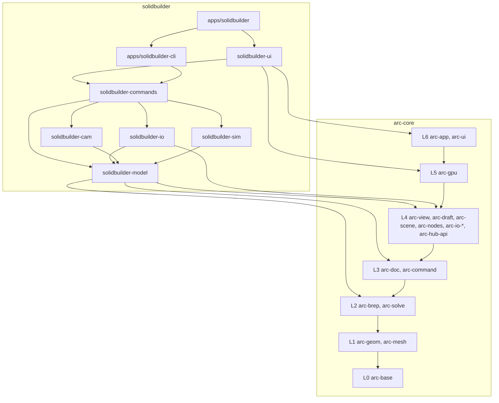
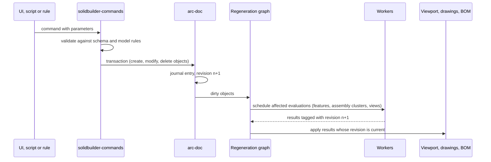

# Architecture overview

This document describes how SolidBuilder is built on `arc-core`: its crates, runtime flows,
subsystems, threading, performance targets, automation surface and testing strategy. Suite-wide
architecture and decisions are in [arc-suite](https://github.com/ACKaraca/arc-suite) and its
[ADRs](https://github.com/ACKaraca/arc-suite/tree/main/docs/adr).

## Crates

| Crate | Layer role | Responsibility |
|---|---|---|
| `solidbuilder-model` | Domain (headless) | Domain objects of the [domain model](domain-model.md); feature evaluators; persistent references; feature history and regeneration rules; assembly relation building; drawing view definitions; bill of materials derivation; sheet metal, frame, weldment and plastic logic |
| `solidbuilder-commands` | Domain (headless) | User-level commands with parameter schemas and prompt machines; validation; the text form reader and writer; rules and forms runtime |
| `solidbuilder-io` | Domain (headless) | Mapping between the domain model and the neutral models of `arc-io-*` crates; import records, loss reports, linked imports |
| `solidbuilder-cam` | Domain (headless) | Manufacturing setups, toolpath kernels, stock simulation, intermediate toolpath format, post-processor host. Created at the manufacturing milestone ([ADR 0006](../adr/0006-external-solvers-and-owned-toolpath-kernels.md)) |
| `solidbuilder-sim` | Domain (headless) | Study definitions, idealization, solver adapters writing decks and reading results, result fields. Created at the simulation milestone |
| `solidbuilder-ui` | UI | Tools, panels, viewport interaction, property editors, drawing sheet editor (egui) |
| `apps/solidbuilder` | Application | Desktop application wiring |
| `apps/solidbuilder-cli` | Application | Headless CLI: convert, validate, regenerate, publish, run scripts, serve the automation protocol |

The two optional crates exist because they have a second consumer (Arc Hub workers) and heavy,
independent dependencies; everything else stays in the four template crates until a second boundary
appears.

Everything except `solidbuilder-ui` and `apps/solidbuilder` builds headless.

## Use of arc-core

| Crate | Used for |
|---|---|
| `arc-base` | Stable IDs, quantities and units (metres, radians internally), tolerances, errors |
| `arc-geom` | Sketch curves, 2D regions for profiles, NURBS for surfacing curves, spatial indexes, toolpath geometry |
| `arc-mesh` | Mesh bodies, subdivision surfaces for freeform bodies, mesh booleans, simplification, stock models |
| `arc-brep` | Exact solids and sheets: every modeling operation, persistent naming, sectioning, tessellation, mass properties ([geometry kernel](geometry-kernel.md)) |
| `arc-solve` | Sketch constraint solving, assembly solving, the expression and parameter engine |
| `arc-doc` | Object store, transactions, journal, dependency graph and regeneration scheduler, external references, document package |
| `arc-command` | Command registry, prompt machines, macro recording, automation protocol endpoint, headless runner |
| `arc-view` | Drawing view projection, hidden-line removal, section cuts |
| `arc-draft` | Drawing sheets, annotations, dimensions, tables, plot output |
| `arc-scene` | Appearances and scenes exported to RenderBuilder |
| `arc-nodes` | Visual rules and node-graph driven features |
| `arc-io-step`, `arc-io-mesh`, `arc-io-dxf`, `arc-io-dwg`, `arc-io-pdf`, `arc-io-ifc`, `arc-io-usd`, `arc-io-pointcloud` | Format reading and writing ([interoperability](interoperability.md)) |
| `arc-hub-api` | Arc Hub versions, locks, lifecycles, items, issues, jobs |
| `arc-gpu` | Viewport, picking, section planes, realistic display |
| `arc-ui`, `arc-app` | Workspace, panels, model tree, property grid, node editor, shell, settings, plug-in loading, assistant panel |

## Runtime flows

### Edit flow

1. A command validates its inputs and opens a transaction; nothing changes the document outside a
   transaction.
2. Committing records element-level operations in the journal and increments the revision.
3. The dependency graph marks dependent objects dirty: features after the edited one in the same
   history, components that reference the edited component, assembly clusters containing affected
   occurrences, drawing views and tables showing them, toolpaths and studies derived from them.
4. Evaluations run on worker threads. Each result carries the revision it was computed from; a result
   for an older revision is discarded.
5. The viewport updates first (tessellation), then drawings, bills of materials and downstream
   manufacturing and simulation, which are marked out of date until recomputed or recomputed on demand.

### Open flow

The package opens its metadata and object tables, then loads cached geometry and tessellation if the
cache revision matches; otherwise it regenerates in the background while showing the cached display.
Large assemblies open with lightweight loading: tessellation and structure first, exact geometry on
demand.

### Product-specific subsystems

| Subsystem | Location | Summary |
|---|---|---|
| Feature history and persistent naming | `solidbuilder-model` | [Feature history](feature-history.md) |
| Geometry kernel use | `solidbuilder-model` | [Geometry kernel](geometry-kernel.md) |
| Sketch solving | `solidbuilder-model` over `arc-solve` | Incremental solve while dragging; conflict extraction; DOF analysis |
| Assembly solving | `solidbuilder-model` over `arc-solve` | One system for joints and constraints ([ADR 0004](../adr/0004-one-assembly-solver.md)); cluster decomposition |
| Drawing engine | `solidbuilder-model` over `arc-view`, `arc-draft` | View definitions, background projection, annotation attachment through persistent references |
| BOM derivation | `solidbuilder-model` | Derived on demand from occurrences, configurations and structure kinds; cached per revision |
| Rules and forms | `solidbuilder-commands` | Expression rules evaluated in process; script rules run out of process through the protocol |
| Manufacturing | `solidbuilder-cam` | Setups, toolpaths, simulation, posting |
| Simulation | `solidbuilder-sim` | Studies, meshing and solver adapters |
| Electronics exchange | `solidbuilder-io` | Board outline, component placement and keep-out exchange with ECAD tools |

## Threading and background work

- The UI thread never waits on geometry. Commands commit on the document thread; evaluation runs on a
  work-stealing pool.
- Independent features (different bodies, different components, parallel branches of the dependency
  graph) evaluate concurrently. Within one feature, operations that `arc-brep` can parallelize (face
  intersections in booleans, tessellation of faces) do so.
- Assembly clusters solve in parallel; drawing views project in parallel per view; tessellation runs
  per body.
- Long operations (imports, toolpaths, studies, batch jobs) are cancellable jobs with progress; a
  cancelled job leaves the document unchanged.
- Kernel calls that are not thread-safe in a given implementation are serialized behind the
  `arc-brep` API, never in product code.

## Performance targets

Targets are acceptance budgets on a reference workstation defined in the suite's performance policy;
they are design goals, not measured results.

| Target | Value | Rationale |
|---|---|---|
| Sketch drag response, 200-entity sketch | under 16 ms per solve | Keeps dragging at display rate |
| Regenerate after editing feature 150 of a 300-feature part | under 1 s to updated display | Interactive parametric editing must feel immediate |
| Full regeneration speed-up on 8 cores, parts with independent bodies | at least 4x over 1 core | Parallel regeneration is a product promise |
| Open a 10,000-occurrence assembly with lightweight loading | under 10 s to navigable display | Large assemblies must be reviewable without full load |
| Viewport frame rate, 5 million triangles | at least 60 frames per second | Smooth navigation in large models |
| Drawing view update after a model edit, 20-view sheet | first updated view under 1 s, all views under 10 s | Background projection keeps drawings usable during edits |
| Command latency for automation protocol queries | under 5 ms for single-object queries | Scripts and assistants issue many small queries |

## Automation surface

| Surface | Description |
|---|---|
| Commands | Every operation is a registered command ([automation](../product/capabilities/16-automation-and-api.md)) |
| Arc Automation Protocol | JSON-RPC over stdio or a local socket; versioned modeling API ([ADR 0005](../adr/0005-canonical-text-form.md)) |
| Model Context Protocol | Endpoint derived from the command registry |
| CLI | `solidbuilder-cli` for conversion, validation, regeneration, publishing, batch jobs and protocol serving |
| Text form | Canonical, diffable text of component feature histories |
| Node graphs | Visual rules and node-driven features on `arc-nodes` |
| Plug-ins | Sandboxed WebAssembly plug-in features, commands and post-processors |

## Testing strategy

| Test kind | Purpose |
|---|---|
| Feature unit tests | Each feature type: valid inputs, failure inputs, naming of every created entity, text form round trip |
| Naming regression corpus | Models with scripted upstream edits; asserts that every downstream reference resolves to the intended entity or is reported broken |
| Regeneration determinism | The same document regenerates to identical topology and names on 1 and N threads |
| Solver tests | Sketch and assembly systems with known solutions, conflicts and degenerate cases |
| Drawing golden tests | Projected views and annotations compared with reviewed vector references |
| Interchange round trips | STEP and mesh exports re-read by an independent reader; corpus imports with expected loss reports |
| Merge tests | Branch pairs with known automatic merges and known conflicts |
| Performance tests | Budgets above, run on the reference configuration; regressions fail CI |
| Fuzzing | Importers, text form reader and protocol messages |
| Kernel regression corpus | The SolidBuilder corpus that any `arc-brep` implementation must pass ([geometry kernel](geometry-kernel.md)) |
